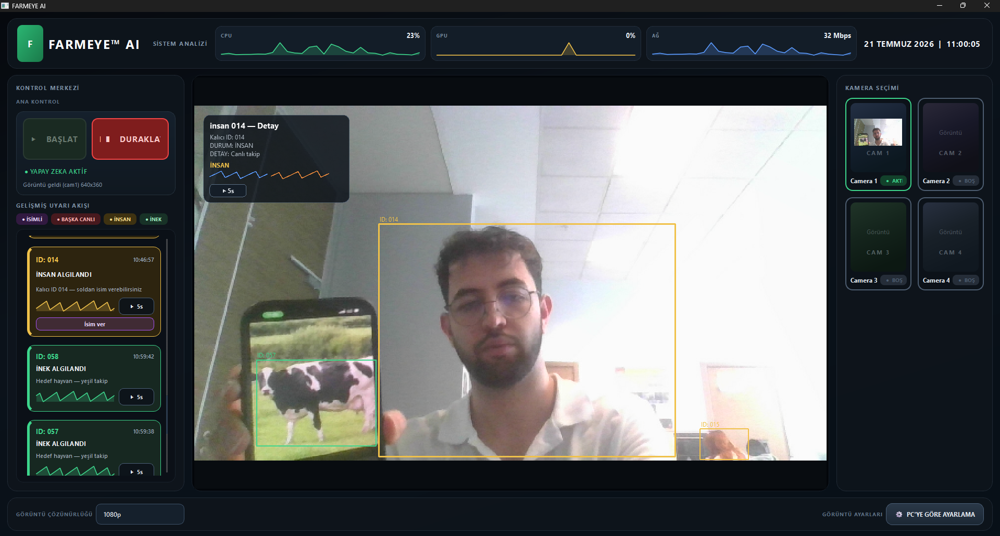
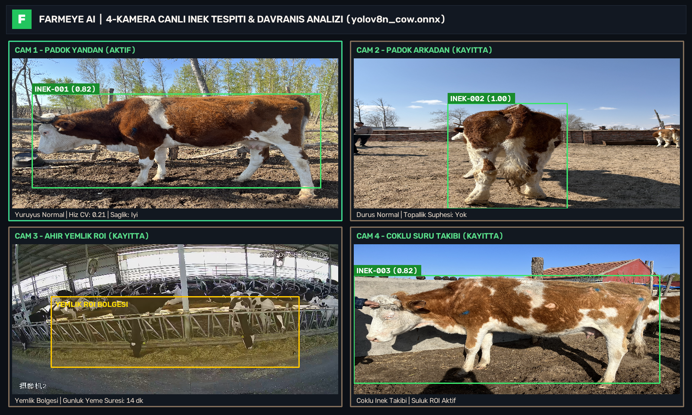
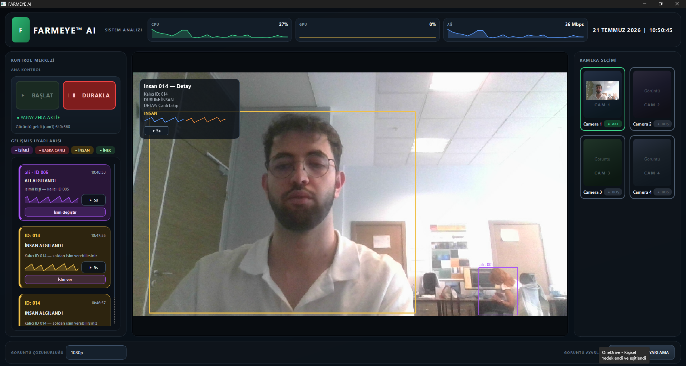
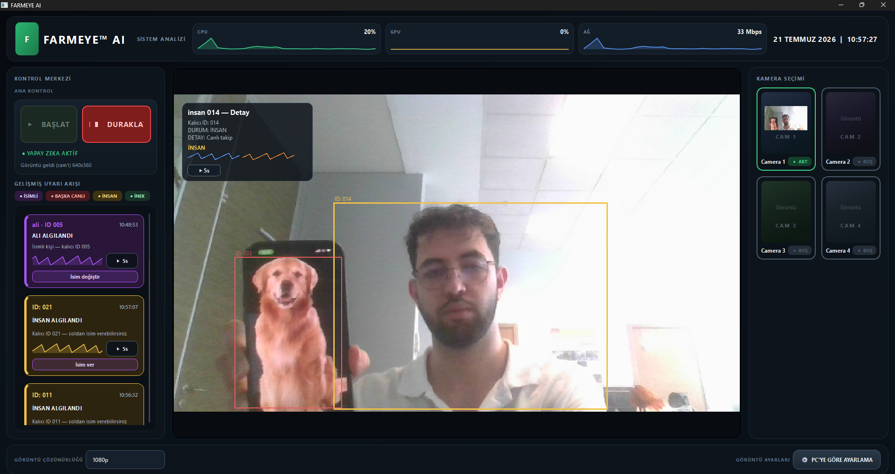
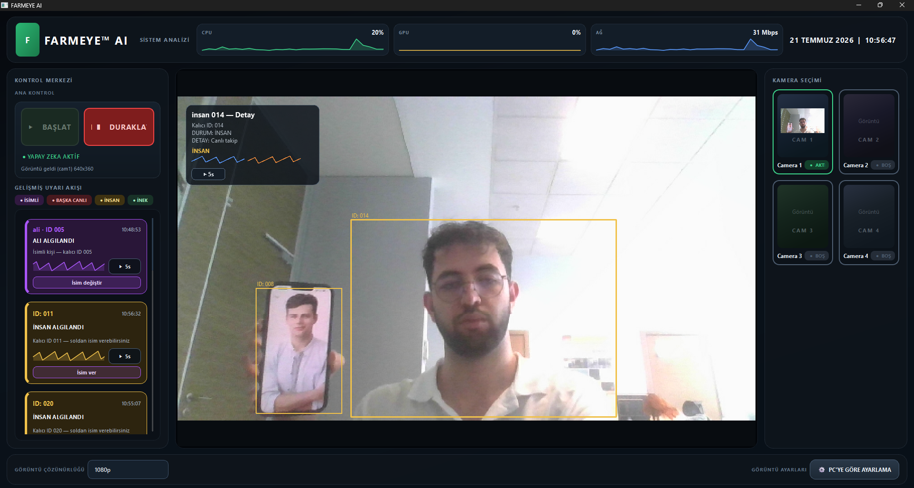
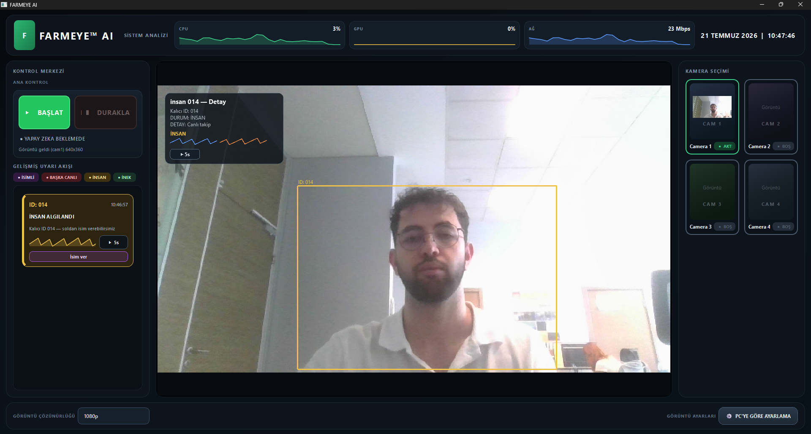
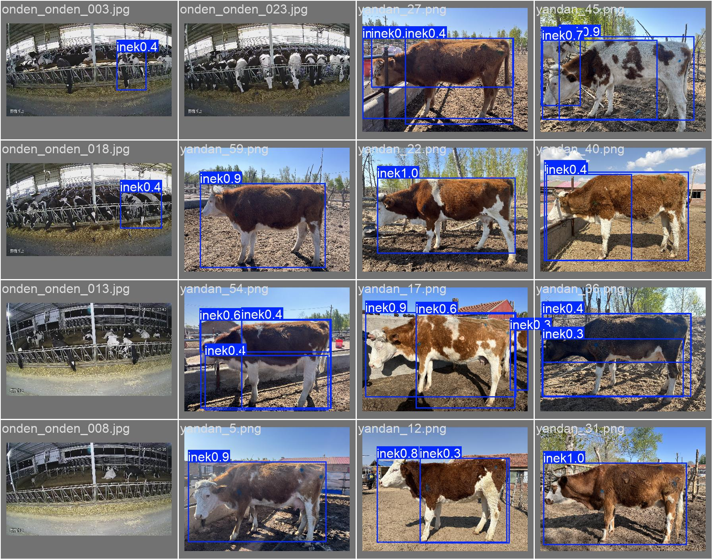
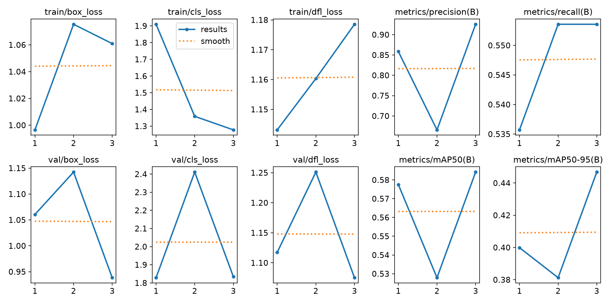
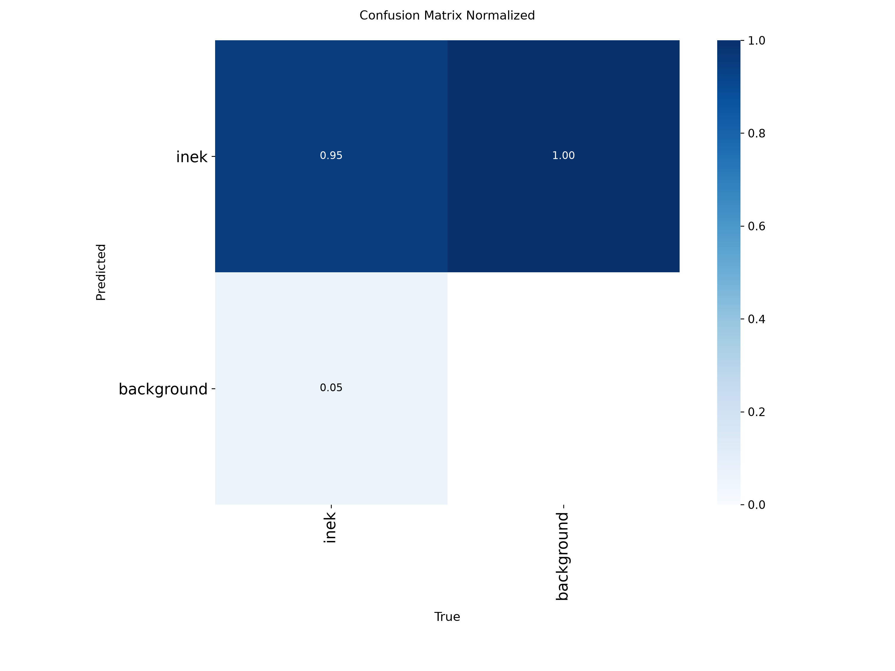
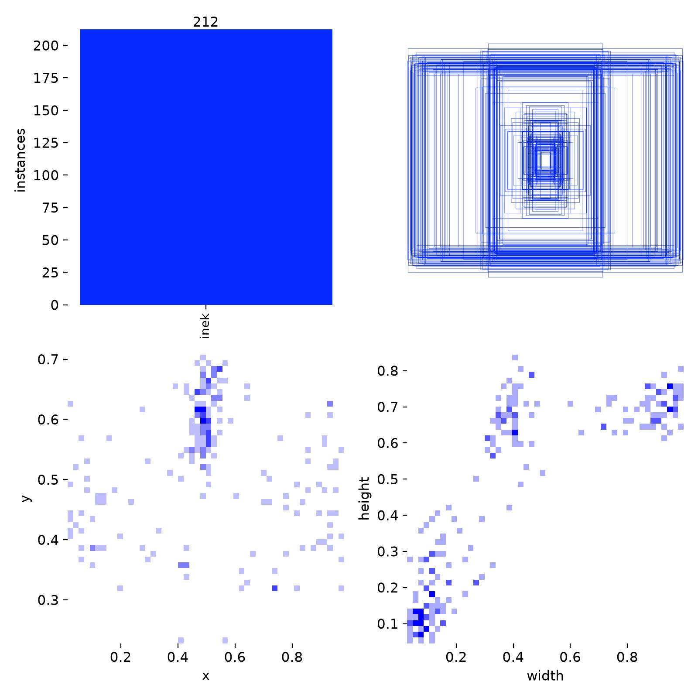

# 🐄 FARMEYE™ AI — Akıllı Çiftlik Gözetim, İnek Davranış Analizi ve Güvenlik Sistemi

<p align="center">
  
  
  
  
  
  
</p>

**FARMEYE™ AI**, büyükbaş hayvancılık işletmeleri ve modern çiftlikler için geliştirilmiş, **C++17, Qt6 (OpenGL), GStreamer, OpenCV DNN ve özel eğitilmiş YOLOv8 (`yolov8n_cow.onnx`)** tabanlı gerçek zamanlı bir **akıllı sürü takip, davranış analizi ve çevre güvenlik sistemidir**.

---

## 🌟 Temel Özellikler

- **🐄 Özel Eğitilmiş YOLOv8 İnek Modeli (`yolov8n_cow.onnx`):**
  - Arkadan (`72` görüntü), yandan (`71` görüntü) ve önden/ahır içi (`25` görüntü + CBVD-5 video veri seti `3.199` kare etiketi) toplam **168 yüksek çözünürlüklü sahne ve 212 inek örneği** ile ince ayar (fine-tune) yapılmış özel model.
  - Doğrulama setinde **%92.5 Precision (Kesinlik)** ve normalize karmaşıklık matrisinde **%95 Doğru Pozitif (True Positive)** yakalama başarısı.
- **📊 Gerçek Zamanlı İnek Davranış Analizi (`BehaviorAnalyzer` & `FarmEyeStore`):**
  - **Yemlik & Suluk ROI Takibi:** İneklerin yemlik ve suluk bölgelerinde geçirdiği günlük sürelerin saniye bazında SQLite (`farmeye.db`) veritabanına kaydedilmesi.
  - **Yatma / Dinlenme Tespiti:** Kutu en-boy oranı (`w/h >= 1.55`) analizi ile yatma başlangıç/bitiş olaylarının (`LieStart`, `LieEnd`) izlenmesi.
  - **Erken Topallık Şüphesi (Lameness PoC):** Hareket hızı varyasyon katsayısı (`CV > 0.85`) üzerinden düzensiz yürüyüş ve topallık tespiti (`LimpStart`).
- **👤 Kalıcı İnsan Kimliklendirme (`PersonIdentityStore`):**
  - Çiftlik personeli veya yabancı kişileri renk histogramı + uzamsal izleme (Ghost IoU) ile tekil kalıcı ID (`ID 005`, `ID 014`) altında takip etme ve arayüzden kişi isimlendirme (`people.db`).
- **🚨 Gelişmiş Uyarı Akışı & 5 Saniyelik Olay Klip Kaydı (`FrameRingBuffer`):**
  - **Yeşil:** Hedef hayvan (`İNEK ALGILANDI`)
  - **Sarı / Mor:** Tanımsız veya İsimli İnsan (`İNSAN ALGILANDI` / `ALİ ALGILANDI`)
  - **Kırmızı:** Yabancı / Başka Canlı (`BAŞKA CANLI`)
  - Her uyarı kartında tek tıkla son 5 saniyelik anlık video klibini oynatma (`ClipPlayerDialog`).
- **🎥 4 Kameralı Düşük Gecikmeli GStreamer & OpenCV Pipeline:**
  - RTSP IP kameralar, USB/Webcam ve yerel MP4 video akışlarını eşzamanlı yürüten çok iş parçacıklı (`CaptureWorker` + `InferenceWorker`) mimari.

---

## 📸 Uygulama ve Eğitim Ekran Görüntüleri

### 1. Canlı İnek Tespiti ve Çoklu Uyarı Akışı (Qt6 OpenGL Arayüzü)


### 2. 4 Kameralı Ahır & Padok Canlı Davranış Analizi (`yolov8n_cow.onnx`)


### 3. Kalıcı Kişi Kimliklendirme ve İsimlendirme Akışı (`PersonIdentityStore`)


### 4. Yabancı Canlı / İhlal Tespiti (`BAŞKA CANLI` Alarmı)


### 5. Çoklu Hedef Takibi ve Gerçek Zamanlı Sistem Telemetrisi (CPU / GPU / Ağ)


### 6. Kontrol Merkezi ve Başlangıç Görünümü


---

## 🧠 YOLOv8 İnek Modeli Eğitim Sonuçları

Çiftlik veri seti (`arkadan`, `yandan`, `onden` ve `CBVD-5` ahır videoları) kullanılarak eğitilen `yolov8n_cow.onnx` modelinin doğrulama çıktıları:

| Metrik | Değer |
| :--- | :--- |
| **Model Mimarisi** | YOLOv8n (Custom Single-Class `inek` + COCO Multi-Class) |
| **Giriş Çözünürlüğü** | `640 x 640` (Letterbox) |
| **Precision (Kesinlik)** | **0.925 (%92.5)** |
| **True Positive (Karmaşıklık Matrisi)** | **0.95 (%95.0)** |
| **mAP@50** | **0.584** |
| **Çıkarım Formatı** | ONNX (`models/yolov8n_cow.onnx` & `models/yolov8n.onnx`) |

### Doğrulama Seti İnek Tahminleri (`val_batch0_pred.jpg`)


### Eğitim Kayıp ve Başarım Grafikleri (`results.png`)


### Normalize Karmaşıklık Matrisi & Veri Seti Etiket Dağılımı
| Karmaşıklık Matrisi (`confusion_matrix_normalized.png`) | Veri Seti Etiket Dağılımı (`labels.jpg`) |
| :---: | :---: |
|  |  |

---

## 🏗️ Proje Mimarisi

```text
FARMEYE-AI/
├── CMakeLists.txt                  # C++17 CMake yapılandırması (farmeye_engine & FarmEyeAI)
├── Dockerfile                      # Multi-stage Ubuntu 24.04 C++17 / Qt6 / OpenCV / GStreamer imajı
├── docker-compose.yml              # Headless Engine ve Qt6 UI servis tanımları
├── config/
│   └── cameras.json                # 4 kameralı RTSP / Webcam / MP4 kaynak yapılandırması
├── models/
│   ├── yolov8n.onnx                # Çok sınıflı (İnek, İnsan, Başka Canlı) genel ONNX modeli
│   └── yolov8n_cow.onnx            # Çiftlik veri setiyle eğitilmiş özel inek ONNX modeli
├── src/
│   ├── main.cpp                    # Qt6 masaüstü uygulaması giriş noktası
│   ├── app/
│   │   ├── pipeline_controller.*   # Çoklu kamera CaptureWorker & InferenceWorker yönetimi
│   │   ├── behavior_analyzer.*     # Yemlik/Suluk ROI, yatma ve topallık analizi
│   │   ├── farmeye_store.*         # SQLite inek davranış ve günlük özet veritabanı (farmeye.db)
│   │   ├── person_identity_store.* # Kalıcı insan ID ve isimlendirme veritabanı (people.db)
│   │   ├── frame_ring_buffer.*     # Sıfır kopya BGR halka tampon ve 5 sn olay klibi
│   │   └── system_monitor.*        # Gerçek zamanlı CPU, GPU ve Ağ bant genişliği izleyici
│   ├── engine/
│   │   ├── engine_main.cpp         # Konsol tabanlı headless AI motoru (farmeye_engine)
│   │   ├── GstCameraCapture.*      # GStreamer + OpenCV VideoCapture hibrit yakalama katmanı
│   │   ├── InferenceEngine.*       # OpenCV DNN YOLOv8 ONNX çıkarım motoru
│   │   ├── class_policy.*          # İnek / İnsan / Başka Canlı sınıflandırma ve iç içe kutu filtreleme
│   │   └── preprocess.*            # 640x640 letterbox ve orijinal koordinat geri eşleme
│   ├── tracking/
│   │   └── tracker.*               # IoU + merkez mesafesi tabanlı çoklu nesne takipçisi (MOT)
│   └── ui/
│       ├── mainwindow.*            # Ana kontrol merkezi ve kamera/uyarı panelleri
│       ├── video_gl_widget.*       # OpenGL hızlandırmalı HUD ve takip kutusu çizimi
│       ├── alert_list_panel.*      # Filtrelenebilir canlı uyarı kartları
│       ├── camera_grid_panel.*     # 4'lü canlı kamera önizleme ızgarası
│       └── clip_player_dialog.*    # 5 saniyelik olay tekrar oynatıcı
└── scripts/
    ├── prepare_and_train_yolo.py   # Eksik etiket tamamlama, CBVD-5 dönüşümü ve veri seti hazırlama
    ├── train_cow_model.py          # YOLOv8 özel inek modeli eğitimi ve ONNX dışa aktarımı
    └── capture_ui_screenshots.py   # Çoklu kamera davranış analizi ve ekran görüntüsü üretici
```

---

## 🐳 Docker ile Çalıştırma

Proje, tüm C++17 bağımlılıklarını (`Qt6`, `OpenCV DNN`, `GStreamer 1.0`, `SQLite3`) içeren çok aşamalı (**multi-stage**) [`Dockerfile`](Dockerfile) ve [`docker-compose.yml`](docker-compose.yml) ile paketlenmiştir.

```bash
# 1. Docker imajını derleyin ve headless AI motorunu başlatın
docker compose up --build

# 2. Tekil video veya RTSP akışı üzerinde konsol motorunu çalıştırın
docker run --rm -v $(pwd)/models:/app/models farmeeye-ai \
  /data/inekvideolar/videolar/1.mp4 /app/models/yolov8n_cow.onnx
```

---

## 💻 Yerel Kurulum ve Derleme (Windows / Linux)

### Gereksinimler
- **CMake** `>= 3.16` & **C++17** uyumlu derleyici (MSVC 2022 veya GCC 11+)
- **Qt 6** (`Widgets`, `OpenGL`, `OpenGLWidgets`, `Gui`, `Sql`)
- **OpenCV 4.x** (`core`, `imgproc`, `imgcodecs`, `highgui`, `dnn`, `videoio`)
- **GStreamer 1.0** *(Opsiyonel — bulunmadığında otomatik olarak OpenCV `VideoCapture` devreye girer)*

### Derleme Adımları
```bash
cmake -B build -G Ninja -DCMAKE_BUILD_TYPE=Release
cmake --build build --config Release
```

### Çalıştırma
```bash
# Masaüstü Qt6 Arayüzü (Windows)
deploy_and_run.bat

# Konsol Motoru (Headless)
./build/farmeye_engine webcam:0 models/yolov8n_cow.onnx
```

---

## 👨‍💻 Geliştirici

**Kadir Duyan**  
GitHub: [@Kadirduyan](https://github.com/Kadirduyan)
